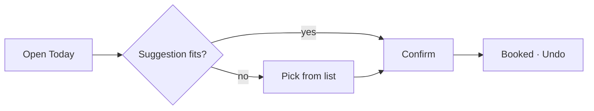

# FL-01 · <flow name>

**Serves:** JOB-01, JOB-03 · **For:** <persona / role> · **Entry:** <where it starts> · **Exit:** <done state>
**Where AI acts:** <step, screen or agent, person's control point>, or none

## Steps
| Step | Person is… | Node | Roles | Decision / input | System does | Failure path → resume |
|---|---|---|---|---|---|---|
| **FL-01.S01** | opening Today | N1.2 | member, admin | — | loads free rooms + one suggestion | load fails → retry banner, list from cache → S01 |
| **FL-01.S02** | picking a room | N1.2 | member | accept suggestion or pick from list | holds room 2 min | room taken meanwhile → two alternatives → S02 |
| **FL-01.S03** | confirming | N1.2 | member | confirm time, duration | books, shows undo | timeout → details kept → S03 |

## Out of scope
- <adjacent flow> (why)
