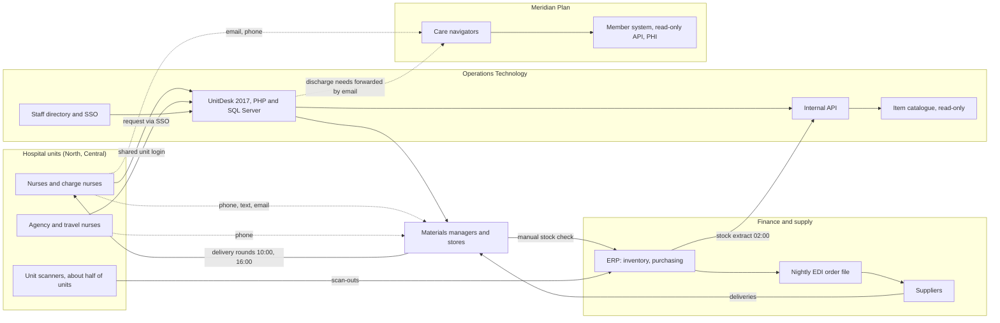

# System architecture: how requests work today

**Author:** Tom Okafor, Engineering Lead, Operations Technology

This shows the systems involved in a request today, and where information moves by hand. The diagram is in Mermaid, which most tools (and Claude) can read.

Dotted lines are manual: phone, text, email or forwarding. None of them are tracked in any system.

## How a supply request moves today

1. A nurse raises a request in UnitDesk, or phones stores.
2. UnitDesk checks the item against the catalogue (free-text names often don't match).
3. Requests under $500 are auto-approved. Over $500 wait for a manager in UnitDesk, then again in the ERP for the purchase order.
4. Materials managers check stock in the ERP (last night's count) and often walk to the stockroom to confirm.
5. If it's in stock, it goes on the next delivery round (10:00 or 16:00, with a 30-minute cut-off).
6. If it needs ordering, it goes in that night's EDI file to suppliers.
7. UnitDesk stays at "Submitted" unless a materials manager updates it by hand.

## How a discharge need moves today

1. A nurse emails the plan, phones the plan's main line, raises an "Equipment" request in UnitDesk, or asks the social worker.
2. If it's in UnitDesk, someone in materials forwards it to the plan by email.
3. A care navigator matches the hospital record number to a plan member ID by hand.
4. The navigator arranges equipment or transport through plan vendors. No confirmation goes back to the unit.

## Where new things could plug in

| New capability | Can connect to | Limits |
| --- | --- | --- |
| Request status | UnitDesk API | Status is only as good as what materials managers update |
| Reorder suggestions | UnitDesk history, catalogue, ERP extract | History misses phone requests. Item names need mapping. Orders still go through the nightly EDI file. |
| Duplicate flags | UnitDesk API | Free-text names make matching fuzzy |
| Stock levels | ERP extract, scanners | Last counted at 02:00. Scans on half of units only. |
| Agency access | Staff directory (new flow needed) | Security will approve time-limited individual accounts |
| Discharge handoff | Member system API | PHI: role-based access and audit. Navigators can't see clinical notes. |
